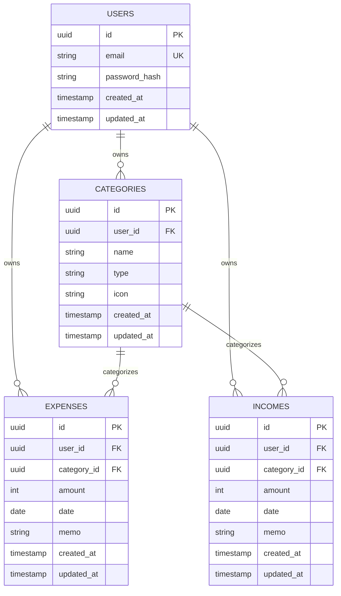

# データベース設計書

## 1. 概要

Kakeiboのユーザー、カテゴリ、支出、収入を管理するデータベースを設計する。

| 項目 | 方針 |
|---|---|
| DB | PostgreSQL |
| ORM | Prisma |
| 主キー | UUID |
| 金額 | 整数（日本円） |
| 日付 | 日付型 |
| 作成・更新日時 | タイムスタンプ |

## 2. ER図

## 3. テーブル定義

### 3.1 USERS

ユーザーのアカウント情報を管理する。

| カラム | 型 | 制約 | 説明 |
|---|---|---|---|
| id | UUID | PK | ユーザーID |
| email | VARCHAR | UNIQUE, NOT NULL | メールアドレス |
| password_hash | VARCHAR | NOT NULL | ハッシュ化済みパスワード |
| created_at | TIMESTAMP | NOT NULL | 作成日時 |
| updated_at | TIMESTAMP | NOT NULL | 更新日時 |

メールアドレスは保存前に正規化し、一意制約によって重複登録を防止する。

認証ライブラリによってユーザー・認証情報の管理方式が変わる場合は、その方式に合わせてこの定義を調整する。

### 3.2 CATEGORIES

収入・支出のカテゴリを管理する。

| カラム | 型 | 制約 | 説明 |
|---|---|---|---|
| id | UUID | PK | カテゴリID |
| user_id | UUID | FK, NOT NULL | 所有ユーザー |
| name | VARCHAR | NOT NULL | カテゴリ名 |
| type | ENUM等 | NOT NULL | `EXPENSE` / `INCOME` |
| icon | VARCHAR | NULL可 | アイコン識別子 |
| created_at | TIMESTAMP | NOT NULL | 作成日時 |
| updated_at | TIMESTAMP | NOT NULL | 更新日時 |

同一ユーザー・同一種別でカテゴリ名が重複しないよう、`user_id`・`type`・`name` の組み合わせに一意制約を設けることを推奨する。

### 3.3 EXPENSES

支出データを管理する。

| カラム | 型 | 制約 | 説明 |
|---|---|---|---|
| id | UUID | PK | 支出ID |
| user_id | UUID | FK, NOT NULL | 所有ユーザー |
| category_id | UUID | FK, NOT NULL | カテゴリID |
| amount | INTEGER | NOT NULL | 支出金額 |
| date | DATE | NOT NULL | 支出日 |
| memo | VARCHAR(500) | NULL可 | メモ |
| created_at | TIMESTAMP | NOT NULL | 作成日時 |
| updated_at | TIMESTAMP | NOT NULL | 更新日時 |

`amount` は1以上の整数とする。DBのCHECK制約またはアプリケーション側の検証で不正な値を防ぐ。

### 3.4 INCOMES

収入データを管理する。

| カラム | 型 | 制約 | 説明 |
|---|---|---|---|
| id | UUID | PK | 収入ID |
| user_id | UUID | FK, NOT NULL | 所有ユーザー |
| category_id | UUID | FK, NOT NULL | カテゴリID |
| amount | INTEGER | NOT NULL | 収入金額 |
| date | DATE | NOT NULL | 収入日 |
| memo | VARCHAR(500) | NULL可 | メモ |
| created_at | TIMESTAMP | NOT NULL | 作成日時 |
| updated_at | TIMESTAMP | NOT NULL | 更新日時 |

## 4. リレーションと整合性

- 1ユーザーは複数の支出・収入・カテゴリを所有する
- 取引は1つのカテゴリに属する
- 取引の `user_id` とカテゴリの `user_id` が一致することを検証する
- 他ユーザーのカテゴリを指定して取引を作成できない
- 参照されているカテゴリの削除方針を明確にする

カテゴリの削除は、関連する取引の整合性を保つため、MVPでは関連取引がある場合に削除を拒否する方式を推奨する。必要であれば、将来「未分類」カテゴリへの移動機能を追加する。

## 5. インデックス

以下のインデックスを検討する。

| テーブル | 対象 | 目的 |
|---|---|---|
| USERS | email | ログイン時のユーザー検索 |
| CATEGORIES | user_id, type | ユーザー別カテゴリ取得 |
| EXPENSES | user_id, date | 月次集計・支出一覧 |
| EXPENSES | user_id, category_id | カテゴリ別集計 |
| INCOMES | user_id, date | 月次集計・収入一覧 |
| INCOMES | user_id, category_id | カテゴリ別集計 |

実際のクエリやデータ量を踏まえてインデックスを追加・調整する。

## 6. 日付・集計ルール

- 取引日には `DATE` 型を使用する
- 作成日時・更新日時にはタイムスタンプ型を使用する
- 月次集計は対象月の開始日以上、翌月開始日未満を条件にする
- 月次収支は「収入合計 − 支出合計」とする
- 日付の表示・変換ルールはアプリケーション内で統一する

## 7. セキュリティ

- すべての取引取得・更新・削除で所有ユーザーを検証する
- クライアントから送信された `user_id` を認証情報として利用しない
- パスワードは安全なパスワードハッシュ方式で保存する
- DB接続情報を環境変数で管理する
- 本番DBの認証情報をGitにコミットしない

## 8. 将来拡張

将来的に以下を追加できる構成とする。

- 月別予算
- 定期取引
- 資産管理
- 貯蓄シミュレーション
- 取引のインポート・エクスポート

## 9. 設計上の注意点

ER図は論理設計である。実装時はPrisma Schemaに変換し、UUIDの扱い、Enum、外部キー、インデックス、削除制約、日時の型を具体化する。

認証ライブラリが独自のユーザー・セッション・認証アカウント用テーブルを必要とする場合は、必要なテーブルを追加する。
