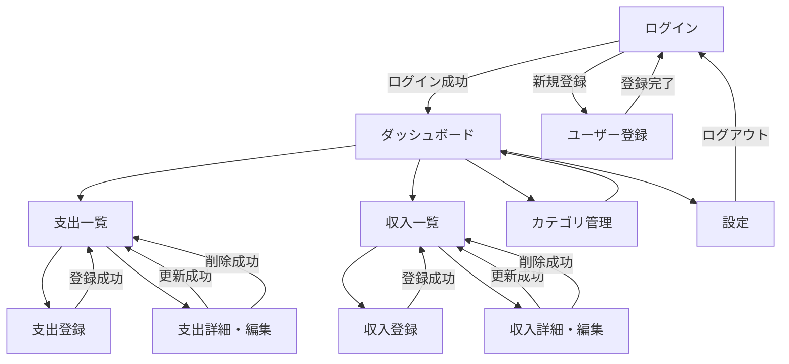

# 画面一覧・画面遷移設計

## 1. 目的

Kakeiboの画面構成、各画面の役割、画面間の遷移を定義する。

## 2. 画面一覧

| ID | 画面名 | パス例 | 認証 | 主な機能 |
|---|---|---|---|---|
| SCR-01 | ログイン | `/login` | 不要 | ログイン |
| SCR-02 | ユーザー登録 | `/register` | 不要 | アカウント作成 |
| SCR-03 | ダッシュボード | `/dashboard` | 必要 | 月次収支・支出内訳 |
| SCR-04 | 支出一覧 | `/expenses` | 必要 | 支出の検索・参照 |
| SCR-05 | 支出登録 | `/expenses/new` | 必要 | 支出の登録 |
| SCR-06 | 支出詳細・編集 | `/expenses/[id]` | 必要 | 支出の参照・編集・削除 |
| SCR-07 | 収入一覧 | `/incomes` | 必要 | 収入の参照 |
| SCR-08 | 収入登録 | `/incomes/new` | 必要 | 収入の登録 |
| SCR-09 | 収入詳細・編集 | `/incomes/[id]` | 必要 | 収入の参照・編集・削除 |
| SCR-10 | カテゴリ管理 | `/categories` | 必要 | カテゴリの一覧・追加・編集・削除 |
| SCR-11 | 設定 | `/settings` | 必要 | アカウント関連設定（将来拡張を含む） |

## 3. 共通レイアウト

認証後の画面は、共通レイアウトを使用する。

### PC

- サイドバーまたは上部ナビゲーション
- メインコンテンツ
- 必要に応じたアクションボタン

### スマートフォン

- コンテンツを縦方向に配置
- タップしやすい操作領域
- 支出登録へのアクセスを容易にする
- ナビゲーションは画面幅に合わせて簡略化する

## 4. 画面遷移図

## 5. 各画面の仕様

### SCR-01 ログイン

**目的：** 登録済みユーザーがサービスを利用できるようにする。

入力項目：

- メールアドレス
- パスワード

操作：

- ログイン
- ユーザー登録画面へ移動

状態：

- 入力エラー
- 認証失敗
- 通信エラー
- ログイン処理中

### SCR-02 ユーザー登録

**目的：** 新規ユーザーのアカウントを作成する。

入力項目：

- メールアドレス
- パスワード
- パスワード確認（必要に応じて）

登録成功後はログイン画面、または認証済み状態でダッシュボードへ遷移する。どちらにするかは認証実装に合わせて統一する。

### SCR-03 ダッシュボード

表示項目：

- 表示対象月
- 収入合計
- 支出合計
- 収支
- カテゴリ別支出
- 支出内訳グラフ

操作：

- 前月・翌月へ切り替え
- 支出登録画面へ移動
- 収入登録画面へ移動
- 支出・収入一覧へ移動

### SCR-04 支出一覧

表示項目：

- 日付
- カテゴリ
- 金額
- メモ（一覧で必要な場合）

操作：

- 支出登録
- 支出詳細・編集
- 表示期間の絞り込み（初期実装では月単位を優先）

表示状態：

- 一覧表示
- データなし
- 読み込み中
- 取得失敗

### SCR-05 支出登録

入力項目：

- 金額（必須）
- カテゴリ（必須）
- 日付（必須、初期値は今日）
- メモ（任意）

詳細は `expense-registration.md` を参照する。

### SCR-06 支出詳細・編集

- 対象の支出情報を表示する
- 編集して保存できる
- 削除前に確認する
- 自分が所有していない支出にはアクセスできない
- 保存・削除成功後は支出一覧へ戻る

### SCR-07〜09 収入管理

支出管理と同様の構成とし、収入の金額・カテゴリ・日付・メモを管理する。

### SCR-10 カテゴリ管理

- 収入・支出カテゴリを区別して表示する
- カテゴリを追加・編集・削除する
- 使用中カテゴリの削除時は、関連データの扱いを明確にする

初期実装では、関連する取引があるカテゴリの削除を禁止するか、取引側のカテゴリを「未分類」に変更してから削除する方式のいずれかを採用する。実装時にDB設計と合わせて確定する。

### SCR-11 設定

MVPでは必要最小限とし、ログアウトなどの共通操作を配置する。プロフィール編集などは将来拡張とする。

## 6. 共通の画面状態

| 状態 | 表示・動作 |
|---|---|
| Loading | 読み込み中であることを表示 |
| Success | 登録・更新・削除成功を通知 |
| Validation Error | 入力項目の近くにエラーを表示 |
| API Error | ユーザーが理解できるメッセージを表示 |
| Empty | データが存在しないことと次の操作を案内 |
| Unauthorized | 未認証の場合はログイン画面へ誘導 |
| Forbidden / Not Found | 権限がない、または対象が存在しないことを表示 |

## 7. 画面遷移のルール

- 未認証ユーザーは認証が必要な画面を利用できない
- ログイン済みユーザーがログイン画面にアクセスした場合は、ダッシュボードへ誘導してよい
- 登録・更新・削除成功後は、関連する一覧またはダッシュボードに反映する
- 削除操作は誤操作を防ぐため確認を挟む
- 遷移制御だけでなく、API・サーバー側でも認証と所有権を検証する
